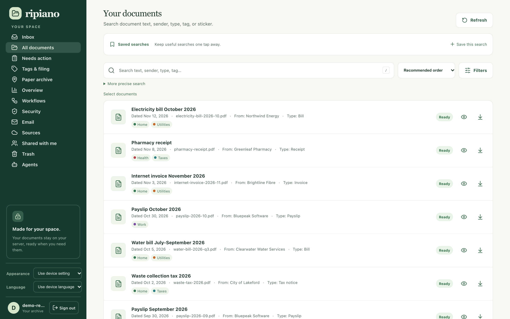
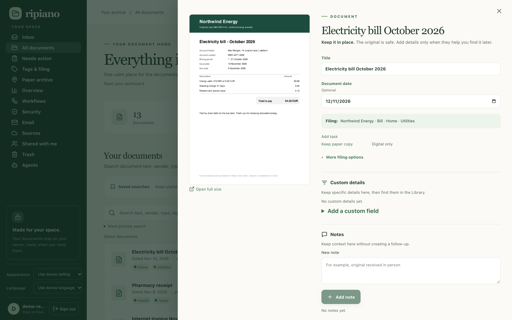

# Ripiano

**A self-hosted document archive for your home server or NAS: snap or upload a document, let Ripiano read it, find it again in seconds, and know which shelf the paper original is on.**

<p align="center">
  
</p>

<p align="center">
  
  &nbsp;
  
</p>

## What it does

- **Scan or upload**: phone camera, photos, PDFs, Office files, and emails; the text is recognised automatically. The document opens with a short filing summary, task and paper actions; manual fields and portable exports stay one tap away. If text recognition is stopped, the Library and document view explain why the file is waiting; people opening a shared waiting document see the same problem and are asked to contact its owner.
- **Find anything fast**: search the words inside every document, or filter by sender, tag, type, or date.
- **Filing help**: matching rules and optional, locally learned automatic filing can add tags, senders, and document types. The learned automatic mode starts off; OCR search works before you configure any filing. Email suggestions ignore recurring recipient and header noise.
- **Dates that matter**: Ripiano can point out an explicit future payment deadline or event date in a document. You decide whether to save a task; **Add to calendar** downloads a local calendar file without an account connection.
- **Personal dashboard**: pin up to six live saved searches for bills, tickets, house papers, or anything else; see counts and recent matches, and optionally open the dashboard first on that device.
- **Paper originals**: keep a paper copy only when useful; Ripiano suggests a broad topic from an unambiguous matching tag, then gives it a sequential code such as `MED-00042`. Its QR label finds the document and current shelf or box. Add or rename paper categories in the Paper archive; if you replace a mistaken label, the old QR still finds the copy. Old `R-…` and location labels still scan.
- **Works on your phone**: install it from the browser on iPhone or Android; an Android app adds a document scanner.
- **Family accounts**: everyone gets a private archive, and you can share single documents or send a link that expires. Optional document email shows the server's sending address before you send.
- **Automatic imports**: optionally pull in files from email, a NAS folder, cloud storage, or a Telegram bot.
- **Readable workflows**: choose a recipe, then configure it in a full-width editor with a live plain-language summary; optional conditions and specialist actions remain available.
- **Private and backed up**: everything stays on your server, with two-step sign-in and scheduled, checked backups. Optional folder templates shape the readable NAS copy without moving originals.
- **AI if you want it**: give an AI assistant limited, revocable access; Ripiano never sends your files to a paid AI service.

Original file bytes are synced before an upload completes. If a mounted filesystem rejects directory sync, Ripiano retries, completes the upload, and records a durability warning in server logs. Other storage I/O errors still fail the upload.

English and Italian interface. Full list: [user guide](docs/USER_GUIDE.md#features-at-a-glance) and [feature parity with Paperless-ngx](docs/FEATURE_PARITY.md).

## Install

You need Docker with the Compose plugin. The stack is defined in [`compose.yaml`](compose.yaml) and builds the images from source:

```sh
git clone https://github.com/p4xx07/ripiano.git
cd ripiano
cp .env.example .env   # set long random RIPIANO_SECRET_KEY, RIPIANO_SETUP_KEY, RIPIANO_DB_PASSWORD
docker compose up --build -d
```

Open <http://localhost:8080> and enter the `RIPIANO_SETUP_KEY` from `.env` to create the owner account. All settings are in the [user guide](docs/USER_GUIDE.md#install-and-run).

- **NAS with pre-built images**: follow [deploy/README.md](deploy/README.md); it works with plain `docker compose` or any tool that runs Compose files.
- **Access from outside** behind one sign-in: the [Raspberry Pi gateway](deploy/gateway/README.md).

## Documentation

- [User guide](docs/USER_GUIDE.md): every feature, setting, and how-to, plus development commands.
- [Backup and restore](docs/BACKUP_RESTORE.md) (with the `/healthz` and `/livez` health checks) and [AI agent access (MCP)](docs/AGENT_ACCESS.md)
- [Android app](apps/android/README.md) and [architecture](docs/ARCHITECTURE.md)
- [Contributing](CONTRIBUTING.md) and [security policy](SECURITY.md)

**Status:** pre-release; see the [quality judges](docs/QUALITY_JUDGES.md) for what still blocks a release. Ripiano is an independent alternative to Paperless-ngx and includes none of its code. License: [LICENSE](LICENSE).
