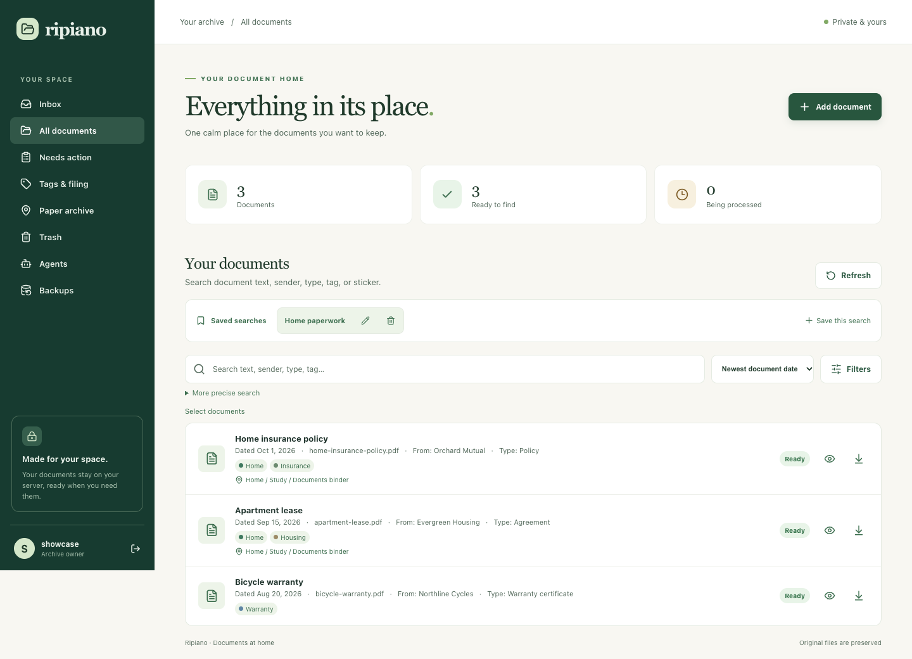
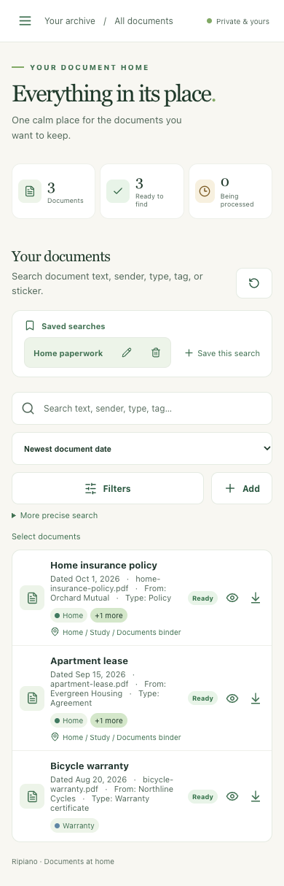

# Ripiano

**A self-hosted document archive for your NAS: snap or upload a document, let Ripiano read and file it, find it again in seconds — and know which shelf the paper original is on.**

<p align="center">
  
  &nbsp;
  
</p>

Ripiano is an independent alternative to Paperless-ngx (v3.4.2 is the feature baseline, no code is shared). It runs as a Docker Compose stack — Django API, OCR workers, PostgreSQL — with an installable web app (PWA) for iOS and Android and an Android client with a native scanner. Everything stays on your server; no cloud AI provider is ever called.

## What it does

**Capture**
- Add documents from the phone camera, gallery, or files: PDF, images, Word/Excel/PowerPoint, OpenDocument, RTF, and emails (`.eml`, `.msg`). The original is always kept unchanged.
- Background OCR turns every document into a searchable PDF. Barcodes on scans can split documents, set an archive number (ASN), or add tags.
- Optional inputs, off until you enable them: a consume folder, watched NAS folders, S3/WebDAV/Google Drive/OneDrive/Dropbox, a Telegram bot, and IMAP mailboxes.

**Find**
- Full-text search with field filters (`tag:`, `sender:`, `date:2026-01..2026-03`, …), saved searches, and matching passages in the results.
- Optional semantic ("search by meaning") search, off by default, using Ollama on another computer or a small model on the NAS.

**File**
- Tags, senders, document types, custom fields, and storage paths, filled automatically by matching rules, workflows, and suggestions learned on your own server from your own choices.
- An exception-only Inbox (failed OCR, duplicates) and a separate Needs-action list for follow-ups.

**Paper copies**
- Give each paper original a QR sticker, place it in nested shelves and boxes, and scan the sticker or shelf label to find it again.

**Sharing and people**
- Multiple accounts with private archives, groups, per-document view/edit sharing, expiring public links, and optional email sending.

**AI through MCP agents**
- Grant an AI agent (for example Claude, or a local Ollama model) narrow, revocable access through MCP: search, read text, tag, or file. Ripiano itself never calls a paid AI API.

**Privacy and backup**
- Two-step sign-in, personal API tokens, scheduled checksum-verified backups for Hyper Backup, a browsable NAS copy, and a portable export to move to a new server.

The interface is in English and Italian. Details for every feature are in the [user guide](docs/USER_GUIDE.md).

## Quick start

You need Docker with the Compose plugin. The default `compose.yaml` builds the images from source:

```sh
git clone https://github.com/p4xx07/ripiano.git
cd ripiano
cp .env.example .env
# edit .env: replace the example RIPIANO_SECRET_KEY, RIPIANO_SETUP_KEY,
# and RIPIANO_DB_PASSWORD with long random values
docker compose up --build -d
```

Open <http://localhost:8080> and enter the `RIPIANO_SETUP_KEY` from `.env` to create the owner (admin) account.

Required variables in `.env`: `RIPIANO_SECRET_KEY`, `RIPIANO_SETUP_KEY`, `RIPIANO_DB_PASSWORD`, `RIPIANO_PUBLIC_ORIGIN` (the exact URL in the browser), and `RIPIANO_ALLOWED_HOSTS` (its hostname). `RIPIANO_PORT` changes the published port (default 8080). Without path variables, data lives in Docker volumes.

### On a Synology NAS (Portainer)

Use the pull-only stack [`deploy/compose.portainer.yaml`](deploy/compose.portainer.yaml) with the values from [`deploy/portainer.env.example`](deploy/portainer.env.example). It maps the database, media, and backup folders to NAS paths (`RIPIANO_DB_PATH`, `RIPIANO_MEDIA_PATH`, `RIPIANO_BACKUP_PATH`), publishes only the web port, and expects an HTTPS `RIPIANO_PUBLIC_ORIGIN`. [deploy/README.md](deploy/README.md) covers image digests, folder permissions (UID 10001), the reverse proxy, and Hyper Backup. No release images have been published yet.

### Access from outside (Raspberry Pi gateway)

To reach Ripiano and other self-hosted services from the internet behind one sign-in, run the Traefik + Authelia gateway on a Raspberry Pi: see [deploy/gateway/README.md](deploy/gateway/README.md).

## Documentation

- [User guide](docs/USER_GUIDE.md): every feature, configuration variable, and how-to.
- [Portainer deployment](deploy/README.md) and [Raspberry Pi gateway](deploy/gateway/README.md)
- [Backup and restore](docs/BACKUP_RESTORE.md)
- [Agent access (MCP)](docs/AGENT_ACCESS.md) and the [optional local Mac classifier](agents/local_classifier/README.md)
- [Android app](apps/android/README.md)
- [Architecture](docs/ARCHITECTURE.md) and [product specification](docs/PRODUCT_SPEC.md)
- [Feature parity with Paperless-ngx](docs/FEATURE_PARITY.md)
- [Agreed decisions](docs/DECISIONS.md) and [implementation plan](docs/IMPLEMENTATION_PLAN.md)
- [Design system](docs/DESIGN_SYSTEM.md)
- [Contributing](CONTRIBUTING.md) and [security policy](SECURITY.md)

## Development

- API tests: `cd services/api && uv sync && RIPIANO_DEBUG=1 uv run pytest -q`
- Web build: `cd apps/web && npm ci && npm run build`
- Android debug build: `cd apps/android && ./gradlew :app:assembleDebug` (JDK 17, Android SDK 36)
- Browser journeys against a running stack: see [Work on the services](docs/USER_GUIDE.md#work-on-the-services).

## Status

Pre-release. Release still requires owner-side checks on the NAS and real devices and the row-by-row verification of the [parity matrix](docs/FEATURE_PARITY.md); see the [quality judges](docs/QUALITY_JUDGES.md) for the release blockers. No Paperless source code is included in this repository. Licensed under the terms in [LICENSE](LICENSE).
