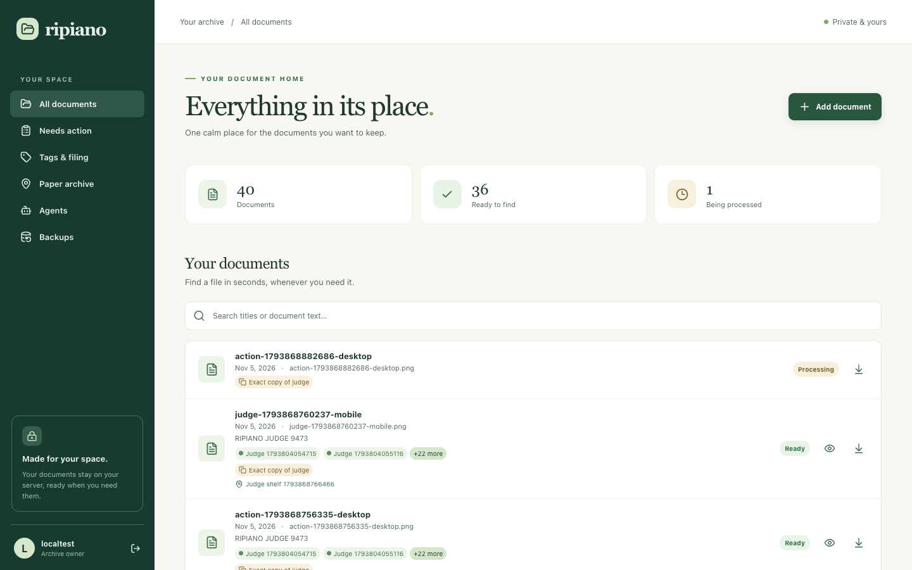
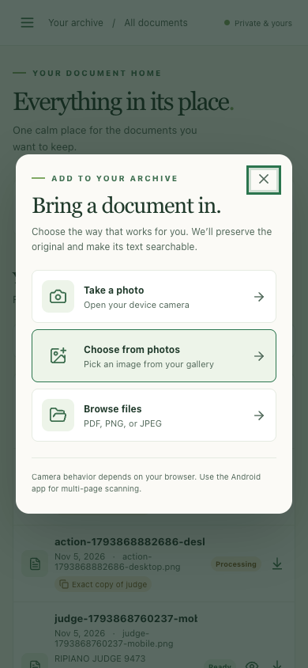
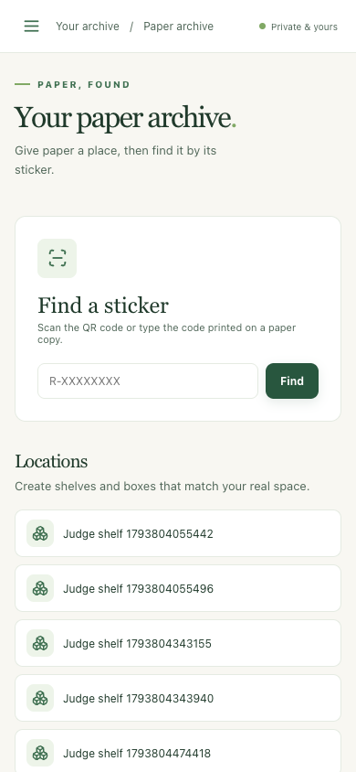

# Ripiano

Ripiano is a self-hosted document archive for a NAS. It combines quick mobile capture, automatic filing, full-text search, and a simple way to locate paper originals with stickers. The web app is an installable PWA for iOS and Android. An Android client shares the web interface and adds a native document scanner.

Ripiano is an independent implementation. Paperless-ngx v3.4.2 is the capability baseline, not a backend dependency or a workflow template. The product target is feature parity with that release plus a better day-to-day filing process.

## Screenshots

These show the running development stack with synthetic test documents. The mobile capture menu is from the PWA; the Android client adds a native multi-page scanner.

| Searchable Library on desktop | Quick capture in the mobile PWA |
| --- | --- |
|  |  |

| Paper archive on mobile | Exception-only Inbox on mobile |
| --- | --- |
|  |  |

| Saved searches on desktop | Saved searches on mobile |
| --- | --- |
|  |  |

| Matching text on desktop | Matching text on mobile |
| --- | --- |
|  |  |

## Planning documents

- [Product specification](docs/PRODUCT_SPEC.md): users, workflows, interaction design, and acceptance criteria.
- [Feature parity](docs/FEATURE_PARITY.md): Paperless capabilities and Ripiano delivery gates.
- [Architecture](docs/ARCHITECTURE.md): services, data model, classification, agents, security, deployment, and backup.
- [Backup and restore](docs/BACKUP_RESTORE.md): mounted volume layout, schedule, and clean-stack recovery.
- [Agent access](docs/AGENT_ACCESS.md): named MCP grants, permissions, and privacy boundaries.
- [Optional local Mac classifier](agents/local_classifier/README.md): Ollama through MCP, 10:00 LaunchAgent, and missed-run catch-up.
- [Implementation plan](docs/IMPLEMENTATION_PLAN.md): build order and verification gates.
- [Quality judges](docs/QUALITY_JUDGES.md): the 9.5 target, independent review rubric, and release blockers.
- [Design system](docs/DESIGN_SYSTEM.md): Ripiano colors, shared controls, focus behavior, and mobile density.
- [Portainer deployment](deploy/README.md): digest-pinned images, NAS volumes, HTTPS, and backup mount.

## First implementation slice

The current slice has owner setup and sign-in, PDF/JPEG/PNG upload, preserved originals, background OCR to PDF/A, text search, a responsive installable PWA, scheduled or manual checksum-verified backups, tags, correspondents, document types, local phrase-based automatic filing, exact duplicate flags, a physical archive, and named MCP agent grants. Camera, gallery, and file selection are available through the browser. A native Android debug build adds multi-page capture and keeps pending scans on-device for retry; it has not passed real-device validation. Paper copies can receive a stable sticker and QR label, be placed in nested locations, and be found again from a sticker link. An agent can be given separate search, OCR-text, and tag-changing permissions, with optional tag filtering, expiry, revocation, and an activity log. An optional Mac worker can ask a local Ollama model to apply existing tags through that grant. Failed OCR can be retried, and the searchable PDF can be opened directly. This is the beginning of the staged implementation, not the complete Paperless feature set. Calibrated pretrained classification, automatic OAuth agent sign-in, and the rest of the [parity matrix](docs/FEATURE_PARITY.md) are still to be built.

### Run locally

Documents can optionally be marked **Needs action** with a due date and note. The separate action list shows only open follow-ups; completing one keeps the document in the archive. Uploading and automatic tags do not require this step.

The **Inbox** shows exceptions only: failed OCR and exact copies that have not been reviewed. Retry OCR or acknowledge that both copies should stay. Ordinary uploads go straight to the Library.

In **Senders** and **Document types**, add a matching phrase to a name to file new and existing documents by title or OCR text. A longer matching phrase wins when more than one name matches; the same phrase cannot target two names of the same kind. The document details show when a value came from a phrase; changing or clearing it there keeps that manual decision on later reprocessing. Automatic tags also stay automatic when you edit an unrelated detail. Tag, sender, and type phrase edits recheck only documents they may affect, so new OCR work is not held behind a full archive pass.

For a batch of files, Ripiano continues after an unsupported file and names each rejected file in the result. Accepted files appear in the Library without another filing step.

1. Copy `.env.example` to `.env` and replace the three example secrets with strong unique values.
2. Run `docker compose up --build -d` from this directory.
3. Open `http://localhost:8080`. Enter the `RIPIANO_SETUP_KEY` from `.env` to create the owner account.

For a NAS deployment, use the [complete Portainer Compose example](deploy/compose.portainer.yaml) and the [example environment values](deploy/portainer.env.example). The example maps the database, media, and backup folders to persistent Synology paths and publishes only the web port; the API, worker, scheduler, broker, and MCP stay inside the stack. Portainer should receive the complete Compose file and the environment variables, with real secrets and released image digests. A short excerpt shows the important mounts:

```yaml
services:
  db:
    volumes:
      - ${RIPIANO_DB_PATH}:/var/lib/postgresql/data
  api:
    volumes:
      - ${RIPIANO_MEDIA_PATH}:/data
      - ${RIPIANO_BACKUP_PATH}:/backup:ro
  worker:
    volumes:
      - ${RIPIANO_MEDIA_PATH}:/data
      - ${RIPIANO_BACKUP_PATH}:/backup
  web:
    ports:
      - "${RIPIANO_PORT:-8080}:8080"
```

This excerpt illustrates storage and exposure; use the linked full stack for deployment. Set an HTTPS `RIPIANO_PUBLIC_ORIGIN`, the reverse proxy hostname in `RIPIANO_ALLOWED_HOSTS`, and give container UID 10001 write access to the media and backup folders. Point Synology's HTTPS reverse proxy at the web port and Hyper Backup at the backup folder's `complete/` subfolder. [Deployment details](deploy/README.md) include image pinning and NAS permissions; [backup/restore instructions](docs/BACKUP_RESTORE.md) cover recovery. Backblaze B2 configuration stays in Synology. A local clean-stack restore passed with documents, locations, duplicate links, and revoked agent grants, but NAS-specific permissions and restore still need verification before storing real documents. No release images have been published from this draft PR yet.

### Work on the services

- API: `cd services/api && uv sync && RIPIANO_DEBUG=1 uv run pytest -q`
- Web: `cd apps/web && npm ci && npm run build`
- Android debug build: `cd apps/android && ./gradlew :app:assembleDebug` with JDK 17 and Android SDK 36. See [Android setup](apps/android/README.md).
- Browser journey (running local stack and a disposable owner account): `cd apps/web && RIPIANO_E2E_ORIGIN=http://localhost:8080 RIPIANO_E2E_USERNAME=... RIPIANO_E2E_PASSWORD=... npm run test:e2e`. This creates test documents, tags, and locations in that account.

The document originals are stored under the mounted media path. OCR output is derived and can be rebuilt. Simple search finds titles, OCR text, tag names, correspondent names, document types, action notes, and sticker codes. Search results show the matching passage from OCR text or action notes, or the matching sticker code; the unfiltered Library stays compact. The Library can narrow results by a specific tag, sender, document type, and document-date range; these filters combine with text search. Save a search to reopen it in one tap; rename it, update its criteria, or delete it from the Library. The Library and Needs action lists load additional results in cursor-based pages of 50; Refresh shows new arrivals. Advanced query syntax remains scheduled for a later slice.

### Optional Telegram input

Create a bot with BotFather. Set `RIPIANO_TELEGRAM_BOT_TOKEN` and `RIPIANO_TELEGRAM_OWNER_USERNAME` in `.env`, then run `docker compose --profile telegram up -d`. Send `/start` to the bot in a private chat; it returns your numeric chat ID. Put that ID in `RIPIANO_TELEGRAM_ALLOWED_CHAT_IDS` and restart the Telegram service. You can now send or forward PDF, JPEG, PNG, or photos to the bot. Each accepted file enters the same OCR and search pipeline as web uploads. For multiple people, list IDs separated by commas; all currently file into the configured owner archive. Only private chats are accepted, and the bot exposes no inbound NAS port.

Telegram's [Bot API limits standard bot downloads to 20 MB](https://core.telegram.org/bots/api#getfile). Telegram handles the file before Ripiano downloads it, so use the direct app upload when the document must never pass through Telegram. Updates remain on Telegram for at most 24 hours; prolonged NAS downtime can miss messages. The bot token must remain secret.

### Optional watched folder

Mount a NAS folder at `RIPIANO_WATCH_PATH`, set `RIPIANO_WATCH_OWNER_USERNAME` to an existing account, and start `docker compose --profile watch up -d`. The mount is read-only to Ripiano. Stable PDF, PNG, and JPEG files are copied into the archive and left in the incoming folder. The same path and bytes import once across restarts; changing a file creates a new document. Files above the configured 25 MB limit are skipped. Set `RIPIANO_WATCH_POLL_SECONDS` to adjust the default five-second poll.

The planning documents remain the implementation baseline. No Paperless source code is included in this repository.
