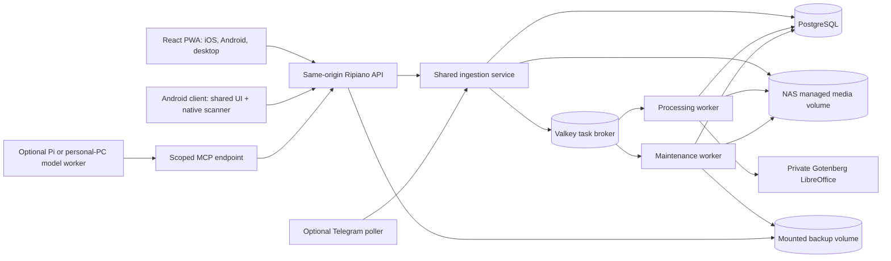

# Architecture and operational design

Status: proposed implementation baseline, 2026-11-04. Exact component versions are pinned during the first implementation milestone.

## Shape

The web/PWA and API are served on one HTTPS origin through the Synology reverse proxy, as in Condivisa. The Portainer stack contains an API/web service, OCR worker, maintenance worker, scheduler, PostgreSQL, Valkey, and a private Office converter. The public entry point is the reverse proxy; database, broker, converter, and MCP internals are not separately exposed to the internet. The Android client can use the same origin over LAN or Tailscale.

External inputs use a shared ingestion service. Each adapter supplies an owner, original bytes, filename, source, and stable source reference. The service validates and durably stores the original, creates the document record, then queues the common OCR/classification pipeline. Source references prevent repeats after adapter restarts. The first adapter is an optional Telegram long poller with a persisted update cursor. It accepts files only from configured private chat IDs, so no inbound webhook port is needed. Standard Telegram Bot API downloads are limited to 20 MB and updates expire after 24 hours. Telegram handles the document before Ripiano receives it, so this input is explicitly less private than direct upload. Future S3, Google Drive, and watched-folder adapters should use the same contract and their own least-privilege credentials and cursors.

### Initial technology choices

- React + TypeScript + Vite + PWA service worker, following Condivisa's source and release shape. Static assets and fonts are bundled locally. The visual tokens and components are Ripiano-specific.
- Python backend with Django and Django REST Framework for migrations, authentication, permissions, and API. Domain services handle document operations; views and models do not absorb the whole workflow. This is a fresh implementation, not a Paperless fork.
- PostgreSQL for canonical metadata, versioned extracted text, and initial full-text search (GIN indexes, structured filters, and trigram support where useful). Search indexing is rebuildable from database content. A dedicated search engine is introduced only if the real corpus shows a relevance or latency problem that PostgreSQL cannot meet. An application query parser preserves advanced search behavior independently of the index implementation.
- Celery with Valkey for asynchronous work, with job state and idempotency keys also recorded in PostgreSQL. Configure broker persistence and reconcile unfinished jobs from the database after restart. One worker processes OCR and retries; another handles rule rechecks and backups. This keeps long maintenance scans from delaying new uploads. Tune concurrency to the NAS after measurement. A single scheduler owns periodic jobs. No document is considered accepted until the original and its database record are durable.
- OCRmyPDF + Tesseract as the initial archival OCR pipeline, with Italian and English language packs. Benchmark PaddleOCR or other engines on real scans before substituting. A private Gotenberg LibreOffice service converts DOCX, XLSX, and PPTX to searchable PDF. Office-derived output currently stays normal PDF because the tested PDF/A step damaged its text map; PDF and image originals still use PDF/A. Preserve the original bytes regardless of derived output.
- Capacitor Android shell around the shared web interface, with a Kotlin bridge to Android's native document scanner. Use the scanner's multi-page PDF/JPEG output, and retain a system camera/file-picker fallback when Google Play services or scanner initialization are unavailable. Flutter would require a second full UI and is not the first choice.

These are starting choices, not assertions that any library is universally superior. The first vertical slice measures OCR quality, search quality, container memory, and Android camera reliability on representative documents and devices.

## Canonical data and storage

Core entities: `Document`, `DocumentVersion`, `OriginalFile`, `DerivedFile`, `Correspondent`, `DocumentType`, hierarchical `Tag`, typed `CustomField`, `Note`, `DocumentLink`, `SavedCollection`, `Workflow`, `MailAccount`, `PhysicalCopy`, hierarchical `Location`, `Sticker`, `Movement`, `ShareLink`, `AgentGrant`, `AuditEvent`, and `Job`.

Each document has a stable UUID. Original files are immutable and checksum-addressed in a managed NAS media volume; derived PDF/A, OCR text, thumbnails, and previews are versioned outputs. Extracted text is also stored with the document version in PostgreSQL so the search index can be rebuilt. User-facing titles and tags may change without renaming original bytes. An on-demand human-readable browse tree can be generated under the mounted backup volume, grouped by year and tag. It copies originals and derived files after checksum checks; it is disposable and separate from restorable snapshots. The managed media tree is the source of truth and must not be edited through SMB. All user data is exportable with an open manifest and original files.

`PhysicalCopy` is separate from `Document`: zero copies means digital only; a document may later gain a physical copy or have more than one. The sticker identifies the physical copy, not a tag or storage path. Location moves and label reprints are audited. Deleting a document with a physical copy prompts for an explicit physical-record decision.

## Ingestion and classification

The pipeline is a state machine: `received -> extracting -> classifying -> filed | review_needed | failed`. A document remains searchable and downloadable once its original is stored, even if later stages fail. Workers retry transient failures with limits; permanent errors show the cause and a retry action. Jobs are idempotent by document/version plus step; duplicate detection is advisory and cannot silently discard an original.

Classification proceeds in layers:

1. Deterministic source and sender rules; barcode/ASN recognition; date/amount/reference extraction.
2. A compact pretrained multilingual text model scores candidate correspondents, types, and tags from OCR text and their descriptions. Initial candidate: multilingual E5 small or a comparably sized model. Scores are calibrated on a held-out local corpus; raw cosine scores are not treated as probabilities.
3. User corrections become examples for nearest-neighbor matching and, when justified by evaluation, optional local fine-tuning. No private corpus training is required to start.
4. Optional stronger local model or agent on a personal computer handles remaining ambiguous documents. It can fetch pending OCR text through scoped MCP access and submit structured proposals. The NAS continues working when this worker is offline.

Automatically apply only fields whose measured precision clears the release threshold. Never infer that a paper original may be discarded. Show evidence and allow undo. A remote model/provider is off by default and requires explicit configuration and data-transfer disclosure. TypeSafe Jev is currently a hosted API and is not the default local classifier.

## Authorization and MCP

Human accounts use server-side sessions, password recovery, two-factor authentication, and optional OIDC. Document, tag, location, and collection visibility are checked by the API. Share links are opt-in, expiring, and revocable; public sharing is disabled by default.

Every agent is a separate principal/grant linked to a human owner. The user signs into Ripiano to approve the connection; neither the agent nor model provider receives the user's password. OAuth-style authorization with PKCE and resource-bound tokens is preferred for MCP clients that support it; a short-lived, revocable manual token can be a compatibility path for local clients. On every request, effective access is the intersection of the owner's current rights and the agent's own scopes and resource filters. A token cannot elevate itself.

| Scope family | Examples | Default |
| --- | --- | --- |
| Discover | List allowed documents and metadata, search | Off until granted |
| Read content | OCR text, previews, originals/downloads as distinct scopes | Off |
| Add | Upload and create documents | Off |
| Organize | Edit title/date/type/tags, physical locations, notes | Off |
| Automate | Propose or edit rules and scheduled tasks | Off |
| Sensitive | Share, delete, manage users/grants/backups | Off; explicit step-up and human confirmation |

Each grant also records allowed collections/tags, expiry, device/client name, and last use. The server enforces scopes on every call and audits actor, tool, document IDs, action, and outcome without logging full document text. Bulk/destructive operations require explicit approval and support dry-run previews. Revocation is immediate. Multiple agents can have unrelated scopes, even when owned by the same human. The MCP endpoint exposes only tools allowed to the current grant.

Current MCP permissions separate document search, OCR text, tag changes, and sender/type filing. The filing scope lists existing choices and sets one field at a time on an allowed document; it never replaces a human or input-rule choice. Agent-assigned sender/type values are marked as model-origin so matching rules do not erase them, and a human can correct them normally. The bundled Mac classifier still files tags only. Other organize, add, and sensitive scopes in the table above remain planned.

The local model worker is conceptually separate from agent identity. An internal NAS classifier can run as a trusted service without MCP; an external Mac/Pi worker uses an individually named grant. A cloud-model agent may receive content returned by tools despite the MCP server being self-hosted; the connection screen must explain this.

## Scheduling and connectivity

Ripiano's NAS worker performs ingestion, OCR, indexing, rule evaluation, notifications, and backups continuously or on its configured schedule. An optional Mac worker may run at 10:00 Europe/Rome using `launchd` and a local model. It should also check for missed work at login/startup; a powered-off Mac must not cause lost documents. The Mac only needs access to Ripiano's HTTPS/MCP endpoint over Tailscale. Tailnet policy restricts that device to the required destination and port; Ripiano permissions remain a separate layer.

A work-managed Mac is an optional convenience, not the private-by-design default. Local inference means the model provider need not receive content, but the device owner/administrator may have access to files, logs, or the running process. Use personally controlled hardware for a strict no-employer-access boundary.

## Backups, restore, and upgrades

Schedule a backup job to a mounted path configured in Portainer (default daily at 02:00 Europe/Rome, user-configurable). PostgreSQL creates a consistent MVCC dump, then the worker copies immutable media. Confirmed permanent deletion, or a per-owner opted-in daily Trash retention task, creates a durable cleanup job and removes live media under the same lock used by snapshots; an active backup delays cleanup, and completed snapshots retain their own copies until retention removes them. Include application settings and physical location data in the database dump and a versioned manifest/checksum list with each snapshot. Stage under `/backup/staging`; publish only validated snapshots under `/backup/complete`, which is the folder the user selects in Synology Hyper Backup. Reuse unchanged media between snapshots where the backup filesystem supports it. Retention is configurable and never deletes the last known-good snapshot. Report failure in the UI. Restore into an empty stack with a documented command and perform a clean-stack drill before release. API tokens and secrets are rotated or re-issued as part of restore; grant permissions and revocation state remain correct.

Synology Hyper Backup reads the output folder and sends it to Backblaze B2 under the user's configuration. Ripiano does not require or store Backblaze credentials. Backup and restore include application version and schema version so incompatible restores are rejected with an explanation. Pinned container versions and pre-upgrade backups are mandatory.

## Release and privacy defaults

- Publish a pinned `linux/amd64` image for the DS923+ to GHCR and a complete `compose.portainer.yaml`; add ARM server images only after dependency verification. Android builds are a separate release artifact.
- Keep all routine document processing local. No analytics, external fonts, or remote AI calls by default.
- Use HTTPS for browser access and camera APIs. Secure cookies, CSRF protection, upload limits/type validation, converter isolation, and rate limits are part of the API implementation.
- Define file and database migration tests, permission tests, and a restore drill before the first real archive is populated.

## Primary references

- [Paperless-ngx capabilities and workflows](https://docs.paperless-ngx.com/usage/)
- [Paperless-ngx API](https://docs.paperless-ngx.com/api/)
- [OCRmyPDF plugin support](https://ocrmypdf.readthedocs.io/en/stable/plugins.html)
- [Android ML Kit scanner](https://developers.google.com/ml-kit/vision/doc-scanner/android)
- [MCP authorization](https://github.com/modelcontextprotocol/modelcontextprotocol/blob/main/docs/specification/2025-11-25/basic/authorization.mdx)
- [Apple scheduled jobs](https://developer.apple.com/library/archive/documentation/MacOSX/Conceptual/BPSystemStartup/Chapters/ScheduledJobs.html)
- [Tailscale encryption](https://tailscale.com/docs/concepts/can-tailscale-decrypt-traffic)
- [TypeSafe Jev data handling](https://help.typesafe.ai/articles/5974925716-how-is-submitted-data-used-or-retained)
