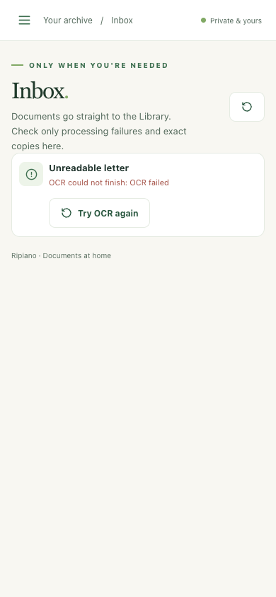
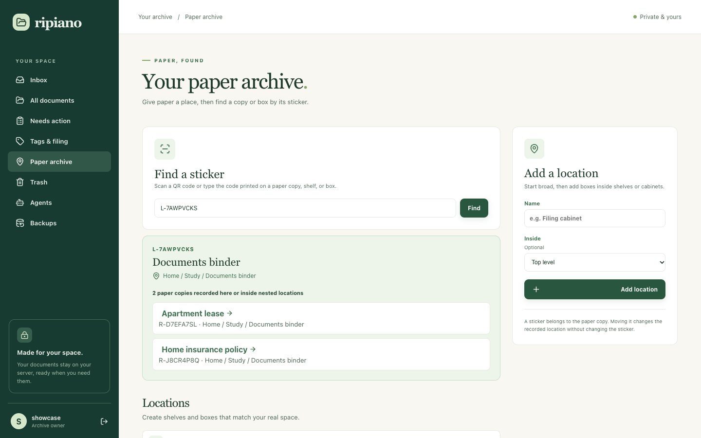
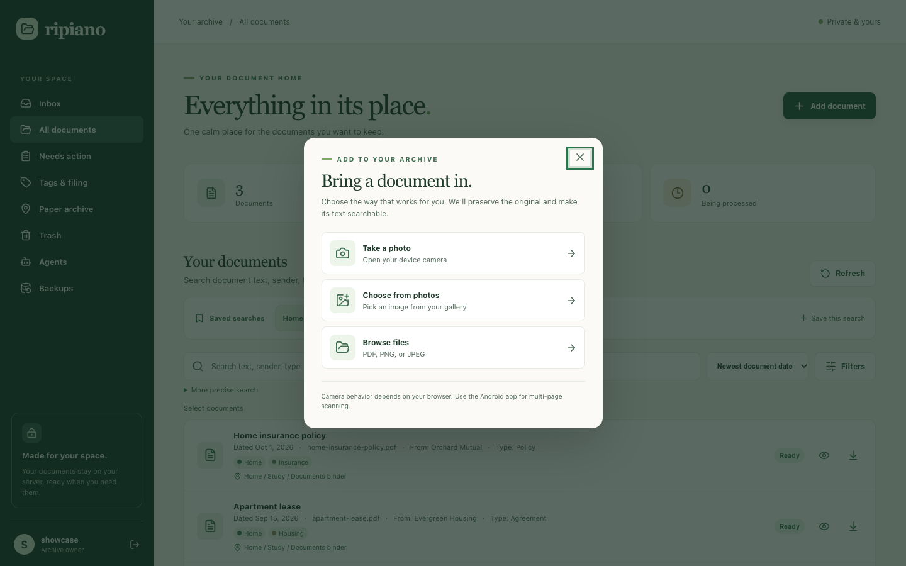

# Ripiano user guide

This guide holds the detailed feature explanations, configuration reference, and how-tos that used to live in the [README](../README.md). For a short overview and the quick start, see the README.

Ripiano is a self-hosted document archive for a NAS. It combines quick mobile capture, automatic filing, full-text search, and a simple way to locate paper originals with stickers. The web app is an installable PWA for iOS and Android. An Android client shares the web interface and adds a native document scanner.

Ripiano is an independent implementation. Paperless-ngx v3.4.2 is the capability baseline, not a backend dependency or a workflow template. The product target is feature parity with that release plus a better day-to-day filing process.

## Features at a glance

This is the summary that used to open the README; each item is explained in the sections below.

**Capture**
- Add documents from the phone camera, gallery, or files: PDF, images, Word/Excel/PowerPoint, OpenDocument, RTF, and emails (`.eml`, `.msg`). The original is always kept unchanged.
- If a session expires while a file is being added, the file waits on that device and resumes after the same person signs in.
- Background OCR turns every document into a searchable PDF. Barcodes on scans can split documents, set an archive number (ASN), or add tags.
- Optional inputs, off until you enable them: a consume folder, watched NAS folders, S3/WebDAV/Google Drive/OneDrive/Dropbox, a Telegram bot, and IMAP mailboxes.

**Find**
- Full-text search with field filters (`tag:`, `sender:`, `date:2026-01..2026-03`, …), saved searches, and matching passages in the results. Common Italian accents can be omitted when typing a search; older indexes update in small background batches.
- Optional semantic ("search by meaning") search, off by default, using Ollama on another computer or a small model on the NAS.

**File**
- Tags, senders, document types, custom fields, and storage paths, filled automatically by matching rules, workflows, and suggestions learned on your own server from your own choices.
- An exception-only Inbox (failed OCR, duplicates) and a separate Needs-action list for follow-ups.

**Paper copies**
- Give each paper original a QR sticker, place it in nested shelves and boxes, and scan the sticker or shelf label to find it again. Moving a copy confirms the change in the document panel.

**Sharing and people**
- Multiple accounts with private archives, groups, per-document view/edit sharing, expiring public links, and optional email sending.

**AI through MCP agents**
- Grant an AI agent (for example Claude, or a local Ollama model) narrow, revocable access through MCP: search, read text, tag, or file. Ripiano itself never calls a paid AI API.

**Privacy and backup**
- Two-step sign-in, personal API tokens, scheduled checksum-verified backups for Hyper Backup, a browsable NAS copy, and a portable export to move to a new server.

The stack is a Docker Compose set of services (Django API, OCR workers, PostgreSQL) with an installable web app (PWA) for iOS and Android and an Android client with a native scanner. Everything stays on your server; no cloud AI provider is ever called.

## Contents

- [Features at a glance](#features-at-a-glance)
- [Current state (first implementation slice)](#first-implementation-slice)
- [Interface language and appearance](#interface-language)
- [Install and run](#install-and-run)
  - [Run locally](#run-locally)
  - [NAS deployment](#nas-deployment)
  - [Work on the services](#work-on-the-services)
- [Adding documents](#adding-documents)
  - [Uploads and file types](#uploads-and-file-types)
  - [Consume folder](#consume-folder)
  - [Folders on the NAS](#folders-on-the-nas)
  - [Telegram](#telegram)
  - [Optional email intake](#optional-email-intake)
  - [Sources (external storage)](#sources-external-storage)
  - [Barcodes on paper scans](#barcodes-on-paper-scans)
- [Finding documents](#finding-documents)
  - [Search](#search)
  - [Optional semantic search](#optional-semantic-search)
  - [Keyboard shortcuts and accessibility](#keyboard-shortcuts-and-accessibility)
- [Filing](#filing)
  - [Inbox and Needs action](#inbox-and-needs-action)
  - [Tags, senders, and document types](#tags-senders-and-document-types)
  - [Matching rules](#matching-rules)
  - [Learned suggestions](#learned-suggestions)
  - [Workflows](#workflows)
  - [Storage paths](#storage-paths)
  - [Custom details](#custom-details)
- [Working with a document](#working-with-a-document)
  - [Notes and change history](#notes-and-change-history)
  - [Related documents](#related-documents)
  - [Pages and versions](#pages-and-versions)
  - [Export](#export)
  - [Trash](#trash)
- [Paper copies](#paper-copies)
- [Sharing](#sharing)
  - [Expiring share links](#expiring-share-links)
  - [Share and email](#share-and-email)
  - [People and sharing](#people-and-sharing)
- [Overview](#overview)
- [Security](#security)
  - [Two-step sign-in](#two-step-sign-in)
  - [API tokens](#api-tokens)
- [Backups and moving](#backups-and-moving)
  - [NAS browse copy](#nas-browse-copy)
  - [Move to a new server](#move-to-a-new-server)
- [Screenshots](#screenshots)
- [Planning documents](#planning-documents)

## First implementation slice

The current slice has owner setup and sign-in, PDF/JPEG/PNG, email (.eml), and Office/OpenDocument/RTF upload, IMAP email intake, preserved originals, background OCR to PDF/A for PDF/images and searchable PDF conversion for Office files, text search, a responsive installable PWA, scheduled or manual checksum-verified backups, tags, correspondents, document types, local phrase-based automatic filing, exact duplicate flags, a physical archive, and named MCP agent grants. Camera, gallery, and file selection are available through the browser. A native Android debug build adds multi-page capture and keeps pending scans on-device for retry; it has not passed real-device validation. Paper copies can receive a stable sticker and QR label, be placed in nested locations, and be found again from a sticker link. An agent can be given separate search, OCR-text, tag-changing, and sender/type-filing permissions, with optional tag filtering, expiry, revocation, and an activity log. An optional Mac worker can ask a local Ollama model to apply existing tags and fill empty sender/type fields through separately granted MCP scopes and write settings. Failed OCR can be retried; ready documents can rebuild the searchable PDF from the preserved original. In Library selection mode, use **OCR actions** to retry failed documents or rebuild searchable PDFs for up to 100 selected documents; files already processing are skipped, and originals remain unchanged. Locally trained filing suggestions can also be applied automatically to new documents when the owner opts in and strict confidence checks pass. AI suggestions and document chat are served through MCP agents rather than by Ripiano calling a model provider (see [DECISIONS.md](DECISIONS.md) D1). Release still requires the owner-side checks on the NAS and real devices and the row-by-row verification of the [parity matrix](FEATURE_PARITY.md); the [quality judges](QUALITY_JUDGES.md) list the release blockers. No Paperless source code is included in this repository; see [LICENSE](../LICENSE) for the license terms.

## Interface language

English is the default interface language on every device. The sign-in screen and the sidebar (Appearance and Language sit just above the account row, always in view) let you switch to Italian or follow the device language instead. The choice is saved in this browser and also controls date formatting and the language requested from the API. Every screen is available in Italian, including Library bulk actions, document detail, mail, workflows, sharing, Sources, Overview and background jobs, semantic search, and People. The Italian source strings received a wording and terminology pass; a full on-device reading pass remains part of release verification. Every API error message is translated for Italian clients; field names inside messages use readable labels (for example “Filtro nome file”), never raw request keys. `archive/test_api_language.py` fails when a new message has no Italian version. Each Telegram source has its own **Bot reply language** (English or Italian), which defaults to the interface language when the source is created.

### Appearance

The Appearance menu offers device setting, Light, Dark, and AMOLED black. The preference stays on the device; AMOLED uses a true black canvas and sidebar.

## Install and run

### Run locally

1. Clone the repository (`git clone https://github.com/p4xx07/ripiano.git`) and copy `.env.example` to `.env`. Replace the example `RIPIANO_SECRET_KEY`, `RIPIANO_SETUP_KEY`, and `RIPIANO_DB_PASSWORD` with long random values.
2. Run `docker compose up --build -d` from the repository root. The default [`compose.yaml`](../compose.yaml) builds the images from source.
3. Open `http://localhost:8080`. Enter the `RIPIANO_SETUP_KEY` from `.env` to create the owner (admin) account.

Required variables in `.env`: `RIPIANO_SECRET_KEY`, `RIPIANO_SETUP_KEY`, `RIPIANO_DB_PASSWORD`, `RIPIANO_PUBLIC_ORIGIN` (the exact URL in the browser), and `RIPIANO_ALLOWED_HOSTS` (its hostname). `RIPIANO_PORT` changes the published port (default 8080). Without path variables, data lives in Docker volumes.

### NAS deployment

For a NAS deployment, use the [complete pull-only Compose example](../deploy/docker-compose.yaml) and the [example environment values](../deploy/env.example). The example maps the database, media, and backup folders to persistent Synology paths and publishes only the web port; the API, OCR worker, maintenance worker, scheduler, broker, and MCP stay inside the stack. OCR work has its own queue so a long rule recheck or backup does not hold new uploads. Whatever runs the stack (`docker compose` or a Compose-based manager) needs the complete Compose file and the environment variables, with real secrets and released image digests. A short excerpt shows the important mounts:

```yaml
services:
  db:
    volumes:
      - ${RIPIANO_DB_PATH}:/var/lib/postgresql/data
  api:
    volumes:
      - ${RIPIANO_MEDIA_PATH}:/data
      - ${RIPIANO_BACKUP_PATH}:/backup:ro
  worker:
    volumes:
      - ${RIPIANO_MEDIA_PATH}:/data
  maintenance_worker:
    volumes:
      - ${RIPIANO_MEDIA_PATH}:/data:ro
      - ${RIPIANO_BACKUP_PATH}:/backup
  web:
    ports:
      - "${RIPIANO_PORT:-8080}:8080"
```

This excerpt illustrates storage and exposure; use the linked full stack for deployment. Set an HTTPS `RIPIANO_PUBLIC_ORIGIN`, the reverse proxy hostname in `RIPIANO_ALLOWED_HOSTS`, and give container UID 10001 write access to the media and backup folders. Point Synology's HTTPS reverse proxy at the web port and Hyper Backup at the backup folder's `complete/` subfolder. [Deployment details](../deploy/README.md) include image pinning and NAS permissions; [backup/restore instructions](BACKUP_RESTORE.md) cover recovery. Backblaze B2 configuration stays in Synology. A local clean-stack restore passed with documents, locations, duplicate links, and revoked agent grants, but NAS-specific permissions and restore still need verification before storing real documents. No release images have been published from this draft PR yet.

For monitoring, `/healthz` answers 200 while the database and the queue server are reachable and 503 otherwise; `/livez` only says Ripiano itself is answering. Details are in [Backup and restore](BACKUP_RESTORE.md#health-checks).

To reach Ripiano from outside the home network through one sign-in, see the [Raspberry Pi gateway](../deploy/gateway/README.md) (Traefik + Authelia).

### Work on the services

- API: `cd services/api && uv sync && RIPIANO_DEBUG=1 uv run pytest -q`
- Web: `cd apps/web && npm ci && npm run build`
- Android debug build: `cd apps/android && ./gradlew :app:assembleDebug` with JDK 17 and Android SDK 36. See [Android setup](../apps/android/README.md).
- Browser journey (running local stack and a disposable owner account): `cd apps/web && RIPIANO_E2E_ORIGIN=http://localhost:8080 RIPIANO_E2E_USERNAME=... RIPIANO_E2E_PASSWORD=... npm run test:e2e`. This creates test documents, tags, and locations in that account.

## Adding documents

### Uploads and file types

For a batch of files, Ripiano continues after an unsupported file and names each rejected file in the result. Accepted files appear in the Library without another filing step.

Word `.docx`, Excel `.xlsx`, and PowerPoint `.pptx` files use the private Gotenberg LibreOffice service in the Compose stack. The original bytes are preserved; a searchable PDF is generated for viewing and search. Older binary `.doc`, `.xls`, and `.ppt` files, OpenDocument `.odt`, `.ods`, and `.odp`, and `.rtf` use the same path; files are checked by content, and OpenDocument or OOXML files with macros are refused. Emails (`.eml`) keep the original message and become a searchable PDF of the sender, recipients, date, subject, text, and attachment names. The page is built from escaped text, so remote images, links, scripts, and styles in the message are never loaded. Outlook `.msg` files are read locally (subject, sender, recipients, date, text, and attachment names) and rendered the same way. Office-derived PDFs currently use normal PDF output because PDF/A conversion damaged extracted text in a real local test. The converter has no published port and does not contact a cloud provider.

The document originals are stored under the mounted media path. OCR output is derived and can be rebuilt.

### Consume folder

Drop files into the consume folder and Ripiano imports them by itself, like Paperless's consume directory. Set `RIPIANO_CONSUME_PATH` (default `/volume1/docker/ripiano/consume`; Ripiano runs as UID 10001 and needs read and write access) and redeploy. Ripiano then adds a built-in **Consume folder** source for the archive owner: it checks every minute, includes subfolders, and removes each file after it is safely imported. A file must be unchanged for a minute first, so a scan that is still being copied is not taken half-done. Unsupported files, hidden files, and links stay where they are. The source appears on the Sources screen, where you can pause it, add filters or tags, or keep files instead of removing them; it cannot be deleted.

### Folders on the NAS

Watched folders are sources too (see [Sources](#sources-external-storage) below). Mount one NAS folder into Ripiano with `RIPIANO_SOURCES_PATH` (default `/volume1/docker/ripiano/sources`; Ripiano runs as UID 10001 and needs read access, plus write access if a source moves or deletes imported files). Then, as the archive owner, add **Folder on the NAS** sources in the app for any subfolder of it, for example the folder your scanner saves to, each with its own filters and after-import action.

### Telegram

Telegram is a source like any other: see [Sources](#sources-external-storage) below. Create a bot with BotFather, paste its token into a new Telegram source, and send `/start` to the bot in a private chat. Your chat appears on the source as waiting; choose **Allow**. From then on, files and photos you send or forward to the bot are imported within about a minute, and the bot answers "Saved to Ripiano."

Telegram's [Bot API limits bot downloads to 20 MB](https://core.telegram.org/bots/api#getfile). Telegram handles the file before Ripiano downloads it, so use the direct app upload when a document must never pass through Telegram. Undelivered messages stay on Telegram for at most 24 hours, so a NAS that is off for longer can miss files. Only private chats you allowed are accepted; groups are ignored, and the NAS needs no inbound port.

### Optional email intake

Open **Email** in the app, connect a mailbox, then add a rule. A rule reads one folder and imports PDF, image, and Office attachments from messages that match its optional sender, subject, text, and file-name filters within a maximum age. After import it can mark the message read, flag it, move it, or leave it unchanged. Ripiano never deletes mail, and each message is handled once per rule even if the read flag is cleared. A rule can add tags, a sender, and a document type; phrase rules do not override them, and you can change them on the document. The maintenance worker checks mailboxes every `RIPIANO_MAIL_POLL_MINUTES` (default 5), and **Check now** runs a check immediately.

Use an IMAP app password where your provider offers one. Passwords and OAuth refresh tokens are encrypted with a key derived from `RIPIANO_SECRET_KEY`. Set `RIPIANO_MAIL_KEY` (a Fernet key) to keep them independent of that secret; changing either key requires entering mailbox passwords again.

Gmail and Outlook can use OAuth instead. Register a web OAuth client with the redirect URI `${RIPIANO_PUBLIC_ORIGIN}/api/mail/oauth/callback`, then set `RIPIANO_GMAIL_OAUTH_CLIENT_ID`/`_SECRET` (Google Cloud: Gmail API, scope `https://mail.google.com/`) or `RIPIANO_OUTLOOK_OAUTH_CLIENT_ID`/`_SECRET` (Microsoft Entra: delegated `IMAP.AccessAsUser.All` and `offline_access`). The matching **Sign in with Google/Microsoft** button appears only when its client is configured. Browser tests use a local GreenMail server: `docker compose -f deploy/compose.mailtest.yaml up -d`.

### Sources (external storage)

Open **Sources** to connect a storage as a document input, much like adding a Hyper Backup destination. Ripiano checks each source on its own schedule and imports new files. Everything is set up in the app; no Compose profile or environment variable is needed.

Available now: **S3-compatible storage** (AWS S3, Backblaze B2, Wasabi, Synology C2, MinIO, SeaweedFS, and others), **WebDAV** (Nextcloud, ownCloud, Synology WebDAV Server, and others), **Google Drive**, **OneDrive**, **Dropbox**, **folders on the NAS**, and **Telegram bots**.

- **Google Drive, OneDrive, Dropbox:** save the source with its folder (a path from the top of the drive, such as `Scans`), then choose **Connect account** on its card and sign in at the provider. Ripiano stores only an encrypted refresh token; **Reconnect** replaces it. Google Docs, Sheets, Slides, and Drawings are imported as PDF exports; forms and shortcuts are skipped. "Delete" after import moves files to the provider's trash, recycle bin, or deleted files, never permanently.
- **Sign-in apps (archive owner):** each provider needs an OAuth app registered once. On the Sources screen, **Sign-in apps** shows the redirect address to register (`<RIPIANO_PUBLIC_ORIGIN>/api/sources/oauth/callback`) and stores each client ID and secret (encrypted). Google: a web OAuth client with the Drive API enabled; Ripiano asks for the full Drive scope so it can move and trash files. A Google app left in "Testing" status signs people out after 7 days; publish it (Google may require verification for the Drive scope) or reconnect weekly. Microsoft: an app registration with delegated `Files.ReadWrite` and `offline_access`. Dropbox: an app with `files.metadata.read`, `files.content.read`, `files.content.write`, and `account_info.read`. The Gmail and Outlook client settings for mail are reused for Google Drive and OneDrive when no app is saved here (add the new redirect address to them).
- **Folder on the NAS:** choose a subfolder of the folder mounted with `RIPIANO_SOURCES_PATH` (archive owner only). Files changed in the last minute wait for the next check, so a scanner still writing is never imported half-done. Hidden files and symbolic links are ignored, and paths can never leave the mounted folder. The check interval can be as short as one minute.
- **WebDAV:** enter the WebDAV address (Nextcloud: `https://cloud.example.com/remote.php/dav/files/USER`; Synology WebDAV Server: `https://nas.local:5006`), the user name, and a password (an app password where offered; stored encrypted). Folders are listed with standard PROPFIND requests, recursively when **Include subfolders** is on (up to 25 levels and 20,000 files per check). Moving creates the dated processed folders; if a file with the same name was already moved that day, both are kept.
- **Telegram:** paste the bot token (stored encrypted). Anyone who writes to the bot is listed on the source as waiting until you **Allow** that chat; you can remove an allowed chat at any time. Ripiano asks Telegram for new messages every minute with a quick request, so no extra process runs. Name patterns, file types, the size limit (20 MB at most), and filing apply as for other sources. **Bot reply language** sets whether the bot answers in English or Italian. **Preview** checks the token and shows the bot's name.
- **Connection (S3):** address, bucket, region, address style (path style for MinIO/SeaweedFS and most self-hosted servers; virtual-hosted for AWS), access key, and secret key. The secret is stored encrypted (with `RIPIANO_MAIL_KEY` or a key derived from the server secret) and never shown again.
- **What to import:** a folder (prefix), **Include subfolders** (recursive) or this folder only, name patterns to include and to skip (for example `fattura*` and `drafts/*`), file types (PDF, images, Office, email), the largest file size (up to the 25 MB upload limit), and an optional "changed after" date.
- **After import:** leave the file and remember it, move it to a processed folder (`<processed folder>/<date>/<original subfolders>`, deleted after a grace period, default 30 days; 0 keeps them), or delete it. Nothing happens to a file until its original is safely stored in Ripiano.
- **Filing:** optional tags, sender, and type for every imported document; your own later choices are never overwritten.
- **Preview** lists what the next check would import and why other files are skipped, without downloading or changing anything. **Check now** runs a check immediately; the card shows the last check, how many files were new, and any problem.
- **Once only:** each file version is imported once, even if its document is later deleted or the service restarts mid-move. A changed file is imported as a new document.
- **Home network:** only the archive owner can connect storage on the home network (for example MinIO on the NAS). Other people can connect internet storage over `https://` only.
- **Least privilege:** give Ripiano its own key that can list the bucket, read and delete under the source folder, and write, read, and delete under the processed folder. With AWS IAM that is `s3:ListBucket` (limited to both prefixes) plus `s3:GetObject`, `s3:PutObject`, and `s3:DeleteObject` on both prefixes.
- **Weight:** sources run on the existing maintenance worker and add no Python packages (Ripiano signs S3 requests itself).

### Barcodes on paper scans

PDF and image scans are checked for QR codes and common 1D barcodes on the NAS. Nothing is sent elsewhere.

- **Separator sheets:** a sheet with the code `PATCHT` splits a multi-page PDF into separate documents and is itself dropped. The full scan is kept unchanged as the hidden source of its parts; open it from any part with **Open full scan**.
- **ASN:** a code such as `ASN00042` gives the document archive number 42. An ASN barcode on a later PDF page starts a new document, even if it is the only ASN; pages before it become an unnumbered first part. Each barcode page stays with its document, and the full scan is kept unchanged and available from the parts. If the scan also has `PATCHT` sheets, those separators take precedence. Numbers are unique per owner. A clash is recorded as a note instead of being assigned, and you can change the number on the document. Search with `asn:42`.
- **Tags:** a code such as `TAG:Bills` adds your existing tag "Bills". In **Tags & filing**, you can also give a tag a unique barcode value (for example `ARCHIVE-BILLS`) and print its QR label. Put that label on a scan's first page to add the tag without exposing its name in the code. The mapping is per account, ignores letter case, and respects tags you manually removed from a document.

Set `RIPIANO_BARCODES=0` to turn this off. `RIPIANO_BARCODE_SEPARATOR`, `RIPIANO_BARCODE_ASN_PREFIX`, and `RIPIANO_BARCODE_TAG_PREFIX` change the codes. Up to 100 pages and the first 500 distinct non-control codes per file are checked (`RIPIANO_BARCODE_MAX_PAGES` controls pages). Physical-copy stickers remain a separate, stable identity for the paper itself.

## Finding documents

### Search

Simple search finds titles, OCR text, tag names, correspondent names, document types, action notes, and sticker codes. A search that is only an archive number, typed as `900011` or as printed on the label (`ASN00900011`), also finds the document with that number in your own Library. Full-text terms must match the query together; a partial rank alone does not pull an unrelated document into results. Search results show the matching passage from OCR text or action notes, or the matching sticker code; the unfiltered Library stays compact.

To narrow search by field, use `title:`, `text:`, `note:`, `tag:`, `sender:`, `type:`, `sticker:`, or `date:YYYY-MM-DD`; quote values containing spaces, such as `sender:"City office"`. Multiple field terms and ordinary text combine. Put `-` before a word or field term to exclude it (`-tag:Draft`), and `OR` between terms when either may match (`tag:Bills OR tag:Car`, `invoice OR receipt`). Date terms accept a year, a month, a day, a range, or a comparison: `date:2026`, `date:2026-01..2026-03`, `date:>=2026-01-01`; `added:` uses the day Ripiano received the document, and `created:` is accepted as another name for `date:`.

The Library can also narrow results with the visual tag, sender, type, and date filters. Save a search to reopen it in one tap; rename it, update its criteria, or delete it from the Library. Sort the Library by relevance, date added, document date, or title; date-less documents stay at the end of document-date sorts.

Select up to 100 loaded documents to add or remove a tag, set or clear the sender, or set or clear the document type, set or clear a shared document date, retry failed OCR, rebuild searchable PDFs, or move a batch to Trash; filing changes count as manual corrections for future automatic filing. Batch actions appear after a document is selected, so the Library stays compact between operations. The Library and Needs action lists load additional results in cursor-based pages of 50; Refresh shows new arrivals.

**Italian field names.** Every field term also has an Italian name, and you can mix them freely: `titolo:` (title), `testo:` (text), `nota:` (note), `etichetta:` (tag), `mittente:` or `corrispondente:` (sender), `tipo:` (document type), `adesivo:` (sticker), `data:` or `creato:` (document date), `aggiunto:` (date added) and `campo:` (custom field). Field names are not case-sensitive. Example: `mittente:"Comune di Esempio" data:2026-11 -etichetta:Bozze`.

**Word forms.** Plain search words match other forms of the same word in Italian and English: "rifiuto" also finds "rifiuti", "bolletta" finds "bollette", "invoice" finds "invoices". Documents containing the exact word you typed are listed first. This uses a stored search index in PostgreSQL that takes about twice the size of the documents' text on disk (about 130 MB per 10,000 typical documents) and makes searches much faster.

### Optional semantic search

**Off by default; Ripiano works fully without it.** When on, plain-language searches in the Library combine keyword and meaning matches in one ranked list. A document found both ways ranks higher; semantic-only matches appear in the same list when similarity is at least 0.3. Field searches and explicit date/title sorts keep their normal behavior. If the model computer is unavailable, the Library still returns keyword results. MCP agents with OCR-text permission keep a `semantic_search` tool that returns passages for the agent's own model to answer from. Ripiano never generates answers and never calls a paid AI provider.

Turn it on as the archive owner under **Agents → Search by meaning**, choosing where the model runs:

| Choice | Cost on the NAS | Notes |
| --- | --- | --- |
| **Off** | nothing | Keyword search only |
| **Ollama on another computer** | nothing | Enter its address, e.g. `http://192.168.1.30:11434`, and run `ollama pull bge-m3` there (or name another embedding model). Meaning search pauses while that computer is off and catches up later. Set `OLLAMA_HOST=0.0.0.0` on the Mac so the NAS can reach it. |
| **On the NAS** | about 800 MB RAM while the model is loaded; about 150 MB of packages and 240 MB of model files in the `ripiano_models` volume | Start the `semantic` Compose profile (the `embedder` service). On first start it installs hash-pinned packages from `services/api/semantic-requirements.txt` into its volume, so the normal Ripiano image does not grow. It runs at low CPU priority with one thread (`RIPIANO_EMBEDDER_THREADS`), capped by `RIPIANO_EMBEDDER_MEMORY` and `RIPIANO_EMBEDDER_CPUS`. |

- **Keep the model loaded:** off by default, so the model unloads after 10 idle minutes and the next search waits while it loads (about 15–20 s on first use). Tick it for faster searches at the cost of permanent RAM. The same setting is passed to Ollama.
- **Database:** passages are stored with the pgvector extension. Set `RIPIANO_DB_IMAGE=pgvector/pgvector:pg17` (same PostgreSQL 17 data directory) and redeploy before turning the feature on; Ripiano says so if the extension is missing. Without it nothing else changes.
- **Indexing** runs in the background on the maintenance queue, 20 documents at a time, after each new document and every 15 minutes. Changed text and a changed model are indexed again. **Test connection** checks the settings before you rely on them; the last problem is shown in the card.
- **Rebuild everything** (for example after changing the model or its settings): `docker compose exec maintenance_worker .venv/bin/python manage.py semantic_rebuild` (add `--owner NAME` for one person). Existing passages keep answering until each document is re-indexed.
- **Quality:** the small NAS model (`paraphrase-multilingual-MiniLM-L12-v2`, Italian and English) is good but not perfect; in a four-document test it found the right document first for three of four questions. Larger models through Ollama (such as `bge-m3`) are better.

### Keyboard shortcuts and accessibility

With a hardware keyboard (shortcuts stay inactive while typing or while a dialog is open):
- **?** lists all shortcuts.
- **/** focuses Library search from any screen; **Esc** in the search field leaves it for the first result, so **J** / **K** / **Enter** work straight away (the search text is kept). **N** opens Add.
- **G** then a letter goes to a screen: **L** All documents, **I** Inbox, **A** Needs action, **T** Tags & filing, **O** Overview, **S** Shared with me, **W** Workflows, **R** Sources.
- In the Library, **J** / **K** move through the list and **Enter** opens the highlighted document; **Esc** closes it.
- **Tab** from the top of the page reaches a **Skip to content** link.

Each screen has its own address (`/inbox`, `/tags`, `/paper`, `/agents`, …) and an open document adds `?document=<id>`, so the browser's Back button, the Android back gesture, and an installed PWA's back go to the previous screen or close the open document instead of leaving Ripiano; addresses can be bookmarked and survive a reload. On phones the closed menu is hidden from Tab and screen readers; opening it moves focus to the current screen's link, and **Esc** or a tap anywhere outside it closes it. On a phone the Library keeps **Add** in the top bar and shows one line of counts; saved searches and the precise-search help open with **Filters**, so the first documents fit on the first screen. If Ripiano cannot be reached, the Library keeps the documents it last loaded and says when they were loaded, instead of showing an empty archive. A file you add is kept on this device from the moment you choose it until Ripiano confirms it has it: if the page is reloaded or closed mid-upload (the browser asks first), the file is still there, the Library says it is waiting to upload, and it is sent once, without a second copy. If you sign out while files are still being sent, Ripiano asks whether to keep or discard them; kept files are sent only after you sign in again on this device, never into another person's account. A finished upload says how many documents were added and offers **Show** (on phones the first new document is brought into view). If the session ends elsewhere, Ripiano returns to the sign-in screen with a short notice and, after signing in, to the same screen.

Dialogs keep focus inside until closed and return it afterwards; a document opened from the Library returns focus to its row, also after the list reloaded. In the Library, Enter on a row you reached with Tab opens that row, and the J/K highlight follows focus. `apps/web/e2e/accessibility.spec.ts` checks the sign-in page and the main screens for controls without names, unlabeled fields, duplicate ids, images without alt text, skipped heading levels, and missing landmarks.

## Filing

### Inbox and Needs action

Documents can optionally be marked **Needs action** with a due date and note. The separate action list shows only open follow-ups; completing one keeps the document in the archive. Uploading and automatic tags do not require this step.

The **Inbox** shows exceptions only: failed OCR, exact copies that have not been reviewed, and damaged PDFs of which only the readable pages could be kept. Such a PDF is searchable and previewable from what was saved; compare it with the paper, re-scan it if pages are missing, and mark it checked to take it off the list. Each card shows its whole explanation, on as many lines as it needs. Retry OCR, keep both copies, or choose **Move this copy to Trash**. After **Retry OCR** the card stays until the new attempt ends, and the result is announced. If that attempt is interrupted, the card says it is taking longer than usual and will be tried again by itself. **Resolve all exact copies** asks first, then keeps every original and moves every listed copy to the Trash, where you can restore it. Ordinary uploads go straight to the Library.



### Tags, senders, and document types

In **Senders** and **Document types**, add a matching phrase to a name to file new and existing documents by title or OCR text. A longer matching phrase wins when more than one name matches; the same phrase cannot target two names of the same kind. The document details show when a value came from a phrase; changing or clearing it there keeps that manual decision on later reprocessing. Automatic tags also stay automatic when you edit an unrelated detail. Tag, sender, and type phrase edits recheck only documents they may affect, so new OCR work is not held behind a full archive pass.

The document dialog shows the document's first page next to the form (above it on a phone, where **Show larger** expands it and **Open full size** opens the searchable PDF), so you can check the sender and date without leaving the dialog. **Create a tag** in the dialog adds a new tag and ticks it; **Save changes** keeps it on the document. If the name you type into **Create a tag**, **Add a type** or **Add a sender** already exists (capitals do not matter), the existing one is chosen instead of a second one being made.

Tags can be grouped under other tags. Create a nested tag from the **Under** picker or move an existing tag from its card. Filtering the Library by a parent finds documents tagged with any nested child, including deeper levels; documents tagged with both parent and child appear once. Agent grants that use a tag filter continue to require the exact granted tag.

### Document dates

When a document is processed and has no date yet, Ripiano looks for the first date near the start of its text (for example "Milano, 10 novembre 2026" or "10/11/2026", read as day/month) and uses it as the document date; emails use the date they were sent. If an email's sender has the same name, address, or domain as one of your senders, the email is filed under that sender (Ripiano never creates senders by itself). A date you enter or clear yourself is always kept, even if you retry text recognition, and the document's Changes list shows "Date and sender detection" for anything Ripiano filled in. Ambiguous numeric dates are read day-first; set `RIPIANO_DATE_ORDER=MDY` or `YMD` to change that, or `RIPIANO_DATE_DETECTION=0` to stop reading dates from text.

### Matching rules

Tag, sender, and document-type rules are under **Tags & filing**. Each rule can match in one of five ways:
- the **exact phrase**;
- **any** of its words (whole words only);
- **all** of its words;
- a **similar spelling**, which tolerates OCR mistakes;
- a **regular expression**, for example `fattura n\. \d+`.

Some limits apply:
- **Regular expressions** use full Unicode case folding, so `Straße` also matches "STRASSE". Each search stops after 0.25 s, and only the first 100,000 characters are searched.
- **Similar spelling** compares up to 6 words against the first 20,000 words of a document, at 85% similarity. One wrong letter in a word of six letters or fewer is not tolerated.
- **Every mode:** rules are evaluated before any database lock is taken.

Existing documents are rechecked in the background when you add or delete a rule. A large archive is rechecked in short steps, so email, source imports, and backups are not held up meanwhile.

### Learned suggestions

For a new archive, upload first: OCR makes every document searchable without any tag or field. **Title** is the findable name; **document date** is detected when possible; **sender**, **type**, and **tags** are optional ways to group or filter. **ASN** is only for numbering a physical paper copy; **follow-up** is only for a task with a due date. You may leave these fields untouched. For recurring bills, make an Email rule that matches the sender or subject and assigns a Bills tag and type; this works immediately without waiting for the learned model.


Ripiano learns from the senders, document types, and tags you set by hand, on your own server. It learns again every night, or when you press **Tags & filing → Learned suggestions → Learn now**.
- **When it suggests:** only when it is at least 60% likely to be right. The probability is calibrated on documents the model had not seen.
- **On a phone**, an open document with suggestions shows a short link above the preview (for example "3 filing suggestions · Go to them") that jumps straight to them.
- **Suggestions from similar documents** list the words both documents share. The words come from the document text, and from the words you wrote into the title. Title words that are also in the upload's file name are ignored, for both these suggestions and the learned ones: this covers a title that is still the file name, the parts of a split scan (named after the scan, such as `scan batch (2/3)`), and a document whose file was replaced. The codes printed under separator and ASN barcodes are ignored too. The model stops using file-name words the next time it learns.
- **Automatic filing is optional:** in **Tags & filing → Learned suggestions**, turn on **File new documents automatically when very confident**. It applies only after OCR on new documents. Each assignment needs at least 90% calibrated confidence, at least 95% measured precision and at least 20 tested suggestions among held-out predictions above that same 90% threshold for that field. It fills empty sender/type fields and adds at most three tags; manual choices, input rules, and removed tags stay in control. You can correct the result in the document dialog. With the option off, suggestions only appear in the dialog and need a tap.
- **File an existing selection:** in **Library → Select documents → File with local model**, choose up to 100 documents and run the same confidence checks once. Documents with no confident new detail stay selected. This one-time action works even when automatic filing for future documents is off; it never changes manual sender/type choices or re-adds a removed tag.
- **A wrong suggestion:** the **×** next to it ("Not right") rejects it for that document, on every device. A rejected tag counts as removed by hand, so rules, workflows, agents, and automatic filing do not add it either; a rejected sender or type is not suggested or filed automatically for that document again. The rejection is listed in the document's **Changes**. Adding the tag or choosing the sender yourself later still works. The learned model does not use rejections as training examples; it keeps learning only from how you file documents.
- **Getting started:** it needs at least 3 hand-filed documents each for 2 or more senders (or types), or 3 documents with the same tag.
- **Privacy and restore:** each person's model uses only their own documents. The model is rebuilt rather than exported; the opt-in setting is included in portable exports. After a restore, automatic filing waits until the model is retrained.

### Workflows

Open **Workflows** to automate routine filing. The page starts with recipes and your existing workflows; choose a recipe or **Start a blank workflow** to open the full-width editor. It shows a live sentence describing the rule, groups optional conditions in columns, and keeps Save visible while you scroll. On a phone it uses the whole screen width. A workflow runs:
- when a document is added (after its first processing);
- when you change a document;
- or each morning for documents a chosen number of days after their added date, document date, or follow-up due date.

**Conditions** are optional and can combine words in the title or OCR text, a tag, a sender, a type, a file-name pattern, and where the document came from.

**Actions** can:
- add or remove tags;
- set a sender or type, but never over one you chose yourself;
- set the title from a pattern (see below);
- set a storage path;
- set one or more custom fields to a value (checked against the field's type when you save, and again when the workflow runs);
- share the document with people or groups, who can view it or also edit its details;
- mark the document as needing action;
- add a note;
- call a webhook;
- send an email;
- unlock password-protected PDFs ("when a document is added" workflows only).

**Title patterns** use the same placeholders as storage paths, plus whole dates and the file name: `{correspondent}`, `{document_type}`, `{date}` (document date, or the added date if there is none, as YYYY-MM-DD), `{year}`, `{month}`, `{day}`, `{added_date}`, `{added_year}`, `{added_month}`, `{added_day}`, `{original_filename}` (without extension), `{title}`, `{asn}`, `{tag}` (first tag alphabetically), and `{source}`. For example `{correspondent} {document_type} {date}`. Unknown placeholders are refused when you save. The result is one line of at most 300 characters; a pattern that comes out empty leaves the title unchanged. The sender and type a workflow sets are applied first, so the pattern can use them.

**Your own choices win:** a workflow never replaces a sender or type you chose, and never replaces a title, storage path, or custom field value that a person changed by hand. Ripiano tells these apart through the document's change history: an edit made by a person (you, or someone you shared the document with for editing) marks that detail as yours. Changes made by an import, matching rules, an agent, or another workflow do not, so a later workflow can still set them.

**Sharing** only adds access: a workflow gives each chosen person or group access if they do not have it yet, and can raise "can view" to "can edit details". It never lowers or removes access, including access you gave by hand. People who are turned off or groups that were deleted after the workflow was saved are skipped. A document can be shared with up to 200 people or groups.

Every change a workflow makes (title, storage path, custom fields, sharing, tags, sender, type) appears in the document's **Changes** history under the workflow's name, and in the run list as, for example, "set title …", "set storage path …", "set field … to …", or "shared with … (view)".

**Unlocking PDFs:** a locked PDF cannot be read for text. Before text recognition, Ripiano tries the saved passwords of each matching "added" workflow, in order. The first one that works produces an unlocked copy, which is used for the searchable PDF, barcodes, and page splits. The original file is kept exactly as uploaded, still locked. Passwords are stored encrypted with the mailbox key (`RIPIANO_MAIL_KEY`, or one derived from the server secret) and are never shown again; the workflow shows only how many are saved. If no password works, the document is marked unreadable with a message saying so. Add the password to a workflow and choose **Retry OCR** on the document. Conditions are checked before text recognition, so a word condition can only match the title at that point.

**Run history:** added and scheduled workflows act once per document; "updated" workflows run again on every matching change, while their notes, webhooks, and emails are still sent only once per document. Every run is listed with what it changed. A run whose every action was held back (for example a tag that limits another agent's access, or a tag you added by hand) is marked **Skipped**, not Applied.

**Notifications:** webhooks and emails include the title, tags, sender, type, and a link, never the OCR text. An email attaches the original only when you tick the option, up to `RIPIANO_EMAIL_ATTACH_MAX_BYTES` (10 MB by default). Webhooks to private, loopback, or link-local addresses are refused unless `RIPIANO_WEBHOOK_ALLOW_PRIVATE=1`, for example for home automation on your LAN. Each webhook call has a 15-second limit. Notes, webhooks, and emails happen once per workflow and document, and "updated" workflows run only after title, date, sender, type, or tag changes. A completed follow-up is never reopened. A new scheduled workflow applies to documents that become due after it was created. Email needs `RIPIANO_SMTP_HOST`, `RIPIANO_SMTP_PORT`, `RIPIANO_SMTP_USER`, `RIPIANO_SMTP_PASSWORD`, `RIPIANO_SMTP_SECURITY` (`starttls`, `ssl`, or `none`), and `RIPIANO_SMTP_FROM`.

### Storage paths

Under **Tags & filing → Storage paths**, define folder layouts such as `{correspondent}/{year}/{month}`. Each layout has a name and a **Folder template**; the hint under the form explains the `/` and `{placeholder}` syntax. Choose one on a document, and the next NAS browse copy places it there instead of under its year.
- **Placeholders:** `{year}`, `{month}`, `{day}`, `{added_year}`, `{added_month}`, `{correspondent}`, `{document_type}`, `{title}`, `{asn}`, `{tag}`, and `{source}`.
- **Safe names:** values are made into safe single folder names. Slashes and reserved names such as `CON` are replaced.
- **Originals:** Ripiano's managed originals never move.

### Custom details

Under **Custom details**, create a text, number, date, or yes/no field once and set it on any document. Only fields with values appear by default; choose an unused field when you need it. A field value is found by ordinary Library search, by a visual field and value filter, or with `field:"Policy number=PN-123"`. Number and date filters accept an exact value or inclusive from/to bounds. Save any visual filter as a search to reuse it. You can rename a field across documents. To change its type, review how every existing value would convert; invalid values and saved searches using the field block the change until you fix them. A successful change converts all values in one database transaction. Delete an unused field after removing its values and saved searches. Custom values are included in the portable document ZIP.

## Working with a document

### Notes and change history

If someone else (or you, in another tab or device) saves a document while you are editing it, your **Save changes** is not applied over theirs. Details only they changed are merged in; for a detail you both changed, the form shows the newer value with yours below it and a **Use my value** button. Check, then save again.

The document panel keeps dated notes separate from follow-ups. Notes can be added or deleted, found through Library search (including `note:`), and retrieved in older pages when the history grows.

Each document also keeps an audit history, shown as **Changes** in the document panel (newest first, the latest five with a "Show all" button) and available at `GET /api/documents/<id>/history` in pages of 50. An entry records when it happened, who or what made it (the person, an agent by its grant name, a workflow, an email rule, a source, matching rules, local learned filing, or barcodes), and each changed detail as "field: old → new" for the title, document date, sender, document type, storage path, ASN, tags, and custom field values. Uploads, new file versions, Trash, restore, and sharing done by a workflow are recorded too. Values are stored as readable names and dates, so entries stay understandable after a tag or sender is renamed or deleted; document text, OCR output, and notes are never copied into the history. Saving without a real change records nothing. Rejecting a filing suggestion ("Not right") is recorded as well, for the owner only. Anyone who can open the document can read its history; people it is shared with do not see owner-only details (storage path, ASN, custom fields, and who else a workflow shared it with). History is part of portable exports.

### Related documents

**Find similar documents** compares distinctive words in the title and first 3,000 characters of OCR text with up to 500 recent ready documents in the same archive. It removes words common across many documents, requires at least three shared words and a minimum overlap score, and shows up to six matches. An identical original is flagged by its checksum. It uses no AI service; with only a few documents, a match can be broad or there may be no result.


The same panel can link related documents. Search for the other document by title or text, then choose **Link**. The connection appears on both documents, so either side opens the other. Moving one document to Trash hides the link until it is restored; its underlying relationship is retained.

### Pages and versions

Open a document and choose **Open pages & versions**:
- **Edit pages:** rotate, remove, or reorder pages, then **Save as new version**. The previous file is kept as an older version, and the searchable PDF is rebuilt.
- **Split:** tick "New document after this page" and choose **Split into N documents**. This creates new documents and leaves the original untouched.
- **Merge:** in Library selection mode, **Merge into one PDF** creates a new document from the selected ones, in the order you selected them.
- **Upload a new version:** replace the current file with a corrected one.
- **Use an existing document:** search in **Pages & versions**, choose a ready document, and copy its current original as a new version. The source remains a separate document, while this document keeps its title, tags, and notes. Its previous file stays downloadable; active share links are revoked because their contents changed.
- **Older versions:** each can be downloaded or made current again. Making a version current adds a new version, so nothing is lost.
- **Signed PDFs:** a digitally signed PDF needs explicit confirmation before editing, because the edited version is no longer signed. The signed file remains as an older version.
- **Non-PDF originals:** page tools work on the searchable PDF.

Document exports include every older version. Only permanent deletion removes version files.

### Export

Under **Files**, **Download original** gets exactly the uploaded file. **Export document ZIP** is for moving one document with its metadata or keeping a portable copy; it includes the preserved original, the searchable PDF and OCR text when available, and a readable `manifest.json` with tags, notes, related documents, and paper-copy history. Each file has a SHA-256 checksum in the manifest. In the Library, select up to 20 documents and open **Export selected** to download one collection ZIP. Its root manifest identifies each document and gives checksums for files in stable ID-based folders. To move the whole archive, see `export_archive` and `import_archive` in [Move to a new server](#move-to-a-new-server).

### Trash

Moving a document to Trash from its panel confirms first, then says "Moved “title” to Trash" with an **Undo** button that restores it straight away.

Move a completed document to **Trash** from its detail panel and restore it later with its original, notes, tags, and sticker history intact. Trashed documents disappear from Library search, Needs action, downloads, and agent tools. A sticker scan explains that its document is in Trash. Processing must finish before a document can be moved. Select documents in the Library to move a batch to Trash after confirmation, and select documents in Trash to restore them together. These actions reject the whole batch if any document is inaccessible or in the wrong state. A confirmed **Delete permanently** action removes the record and paper-copy sticker history, then the maintenance worker removes its live original and archive files after any active backup finishes. Trash shows cleanup status and lets you retry a failed cleanup. Previously completed snapshots may still contain the document until their configured retention expires. Automatic cleanup is off by default. In Trash, choose 30–3650 days and review the current eligible count before enabling a daily 03:00 Europe/Rome cleanup. Disabling it stops future automatic deletions; cleanup already requested still completes.

## Paper copies

Paper copies can receive a stable sticker and QR label, be placed in nested locations, and be found again from a sticker link. A sticker code can be typed with or without its `R-` prefix (`R-MUD3PLDT`, `MUD3PLDT`); a location code typed in full (`L-…`) opens the location.

Scanning or typing a paper copy's sticker (also from the label's QR address on a phone) shows a result card where you can move the copy to another location (choose it and press **Move**), mark it missing or found, print its sticker again, or open the document. Locations are listed in tree order, each box under its shelf.

If a paper copy is missing, mark its sticker **Missing** from the document panel. Ripiano keeps the last known location, shows a warning when the sticker is scanned, and records the report in its history. Mark it **Found** before assigning a new location; the sticker identity stays the same. A paper copy's **History** lists each placement or move with its date, time, and the person who made it.

Each shelf or box also has a stable `L-` code and a printable QR label. Scan it to see the paper copies stored there, including copies in nested locations, or type the code in **Your paper archive**. Large locations load their contents in pages of 50. Missing copies remain listed at their last known location with a warning.



### Editing locations

In **Paper archive → Add a location**, the button tells you where the new location goes ("Add location at top level" or "Add location inside Shelf / Box"). After you add a location, "Inside" goes back to the top level. To fix a mistake, choose **Edit** next to a location. You can rename it or choose a new "Inside" location. Paper copies, stickers, printed labels, and their history stay attached, and any locations inside it move with it. **Delete location** asks you to confirm first. It works only when the location is empty, so move its paper copies and any locations inside it somewhere else first. Printed stickers keep the code on one line and show the innermost locations when the full path is too long.

## Sharing

### Expiring share links

To give someone a document without an account, open **Share original** in its document panel, choose a 1, 7, or 30-day expiry, and create a link. Copy it while it is shown: Ripiano stores only a hash of the token and cannot display that URL later. Anyone with the URL can download the original without signing in. You can revoke an active link at any time; moving a document to Trash revokes its links permanently, even if the document is restored. A link only exposes original file bytes, not notes, tags, OCR text, or the rest of the archive. On a NAS, the recipient must be able to reach the HTTPS `RIPIANO_PUBLIC_ORIGIN`; a Tailscale-only address only works for people on that tailnet.

### Share and email

- **Single document:** a document's **Share original** creates an expiring, revocable link to its original.
- **Several documents:** in Library selection mode, **Share as one link** gives the selected originals (up to 50 documents, 200 MB) as one ZIP download. The link lasts 1–30 days and can be revoked, and each original is checksum-verified while the ZIP is built.
- **New versions:** adding a new version of a document revokes the links and bundles that include it.
- **Password changes:** changing your password under **Security**, or an admin resetting it under **People**, revokes all your share links and bundles at once, like your API tokens and agents (docs/DECISIONS.md D11). They are listed as revoked, marked "password changed"; create new links for anything you still want to share.
- **Turned-off accounts:** turning an account off revokes all its share links and bundles at once (a visitor sees the same "Link not found" as for any unknown link). Turning the account on again does not revive them: the owner sees them as revoked, marked "account turned off", and creates new links if still needed.
- **Email:** **Email this document** sends the original (checksum-verified) or the searchable PDF through the server's SMTP settings. It is off unless the operator sets `RIPIANO_DOCUMENT_EMAIL=1`; SMTP alone (for workflows) does not enable it. Each account can email up to 30 recipients per hour, replies go to the account's email address, and the send history is shown on the document. For local testing, run the existing GreenMail test server (`deploy/compose.mailtest.yaml`), set `RIPIANO_DOCUMENT_EMAIL=1`, `RIPIANO_SMTP_HOST=mailtest`, `RIPIANO_SMTP_PORT=3025`, `RIPIANO_SMTP_SECURITY=none`, and a fake `RIPIANO_SMTP_FROM`, then restart the API and maintenance worker. GreenMail captures these messages locally; it does not deliver them to the internet.
- **Bundle ZIPs:** each bundle's ZIP is built once in the background and deleted when the link ends. Moving a bundled document to Trash or adding a new version revokes the bundle, and restoring the document does not re-share it.

### People and sharing

The first account is the admin. Under **People**, the admin adds people (each gets a private archive), resets passwords, turns accounts off, and creates groups such as "Family".
- **Share a document:** open it, then **People with access → Manage access**. Choose a person or a group and either *Can view* or *Can edit details*.
- **What they get:** the document appears under their **Shared with me**. Viewers can read it, download it, and read its notes. Editors can also change the title, date, and follow-up, and add notes.
- **What stays with you:** unshared filing, files, pages, versions, share links, paper copies, and Trash. Recipients with edit access can use only the tags, senders, and types you separately share with them; they cannot clear or replace a sender or type you kept private.
- **Ending access:** removing a grant, removing someone from the group, turning the account off, or moving the document to Trash all end access immediately.
- **Password rules:** at least 12 characters, wherever a password is set (first-time setup, People, Security). Ripiano refuses a commonly used password, digits only, one or two characters repeated, a row of neighbouring keys or letters, and a password that is little more than the username. It says which rule applied.
- **Passwords and accounts:** a password change or reset ends that person's other sessions, disconnects their API tokens and agents, and revokes their public share links and bundles for good. Turning an account off does the same, also revoking its public share links and bundles, and turning it on again does not revive any of them. API tokens cannot manage people or groups.
- **Caching:** signed-in `/api/` answers and original downloads are sent with `Cache-Control: private, no-store`, so browsers and proxies do not keep copies.

**Sharing tags, senders, types, and saved views:** each has a **Share** button (the people icon) that opens the same people-with-access panel as documents, for a person or a group:
- **Can view and use:** the object appears for them under Shared with me (as a filter), and they can use it to file your documents they have *edit* access to: add or remove your shared tags, and set your shared sender or type. Your other tags on the document are never touched, and archive details (storage path, ASN, duplicates) stay with you.
- **Can also edit:** they can additionally rename it (and change a tag's colour and description, or a saved view's search and dates). Deleting stays with you; deleting an object ends every grant on it.
- A shared **saved view** narrows Shared with me to the documents you shared with them that match it.

## Overview

**Overview** is reached from the sidebar or **Open your dashboard** on the Library. The **Your dashboard** section lets you create up to six live collections from a name, optional search words, and an optional tag. You can also pin an existing saved search with its full filters. Each card shows the matching count and three recent documents; **Open all in Library** applies the saved search. Each person has their own collections. **Open this dashboard first on this device** is a local browser preference, so opening `/` on that device starts on Overview; an explicit Library or document link still opens where it points.

**Overview** also shows:
- totals and storage used;
- what needs a look (unreadable documents, overdue follow-ups, exact copies, mailbox problems, failed workflow runs), each linking to the right screen;
- documents added per month over the last year;
- the most common types, tags, and sources;
- the last backup (for the archive owner);
- **Background jobs**: your documents waiting for or undergoing text recognition, documents that could not be read, permanent deletions that are waiting or failed, the learning job for filing suggestions, and workflow runs that failed this week.

**Background job controls:**
- **Cancel** takes a queued or processing document out of processing. It stays in your archive, marked as not processed, and **Retry OCR** queues it again. You can cancel a document that is being processed at any time, for example when it seems stuck; whatever the worker was doing for it is discarded. The worker itself stays on that file until its current text recognition step ends (up to 55 minutes for a very large scan), so with the default single worker a **Retry OCR** or the next upload waits behind it.
- **Stopped workers:** the Library row, the open document, the Overview, and a retried Inbox card show the same "taking longer than usual" note. While a document is processed, the worker reports every 30 seconds. If it stops reporting for 2 minutes (the worker was restarted, killed, or ran out of memory), the document is marked as stalled and you can **Retry OCR** or **Cancel** it. The scheduler checks every minute and puts it back in the queue once two checks in a row find it stalled, so about 3–4 minutes after the worker stopped; one late report (a clock change, a short database outage) is not counted. A document that stops its worker three times in a row is marked as failed instead of being retried again; **Retry OCR** starts that count afresh, and it is kept apart from failed text recognition. If the worker was alive after all, its late result is discarded: it cannot undo your Cancel or run workflows a second time. Processing again never creates duplicate parts of a barcode-split scan, and files left behind by a stopped run are removed when a worker starts and as soon as the stopped run is noticed (a few minutes). The every-minute check runs on the maintenance worker, so it is not held up by a long text recognition; during a long backup it waits for the backup to finish.
- **No OCR worker running:** each worker reports every 30 seconds, even while it is busy with a long scan. When documents have been waiting for more than 2 minutes and the OCR worker has not reported for 2 minutes (it was stopped, killed, or ran out of memory), Background jobs and the Overview say so and show since when documents are waiting; start the `worker` container again and they are processed once each. Documents that could not be handed to the queue server (Valkey down) are reported as waiting for it, not as being processed. A waiting document is queued once: the every-minute check sends it again only if it never reached the queue server, or if the OCR queue is empty although it has been waiting for more than 5 minutes (the queue server lost it), so the queue count in the Overview stays at most one per waiting document however long the worker is stopped. The `worker` and `maintenance_worker` containers also have a light health check (the age of a file their heartbeat touches), so the NAS container list shows a worker that stopped reporting as unhealthy. In the Library a queued document shows **Waiting** and one being processed shows **Processing**; the Overview counts both, like Background jobs. The archive owner is also told on the Overview when the maintenance worker (backups and scheduled checks) is not running.
- **Retry OCR**, **Retry** (permanent deletion), and **Retry** (learning) restart failed work.
- Failed workflow runs are listed for information; workflows never retry a run by themselves.
- Backups and NAS browse copies keep their own cancel and retry controls under **Backups**.

### Offline

Without a connection Ripiano keeps what it already shows. Files you add while offline wait on this device and are sent automatically when the connection returns, without creating duplicates if an earlier attempt did arrive. If the device is online but Ripiano could not be reached, the waiting files are tried again after about 3, 10 and 30 seconds and then every minute; **Send now** tries at once. If you reload the app while Ripiano cannot be reached, it says whether the device itself is offline or the device is online but the Ripiano server is not answering, shows who was last signed in and how many files are waiting, and it reconnects by itself. Signing out with files still waiting asks whether to keep them for the next sign-in on this device or discard them.

## Security

### Two-step sign-in

Open **Security**, confirm your password, and scan the QR code with any authenticator app. After that, Ripiano asks for a 6-digit code after your password.
- **Recovery codes:** you get 10 single-use codes for a lost phone. They are shown once and stored hashed.
- **Lockout:** after 5 wrong codes, code entry locks for 15 minutes.
- **Storage:** the authenticator secret is encrypted with the same key as mailbox passwords (`RIPIANO_MAIL_KEY`, or one derived from `RIPIANO_SECRET_KEY`). When rotating it, keep the old key listed after the new one in `RIPIANO_MAIL_KEY`.
- **Agents:** agent tokens are separate and unaffected.
- **Admin:** Django admin (`/admin/`) has no separate password form. Sign in to Ripiano first, then open it.
- **Throttling:** failed sign-ins are limited per username and per client address. The counters live in the queue server (Valkey); while it is unreachable, sign-in keeps working, each web process counts failures itself with the same limits, and the api log says `Sign-in throttle unavailable`.
- **Lost phone, no recovery codes:** run `manage.py reset_two_factor <username>`.

### API tokens

Under **Security → API tokens**, create a personal token for your scripts. It is shown once, and you choose an expiry of 7–365 days. Send it as `Authorization: Token rip_…` on `/api/` requests.
- **Access:** the token acts with your access to read, upload, and file documents, and needs no CSRF token. To limit the damage of a leaked token, it cannot: sign in or change account security, other tokens, or agents; manage people or groups; share documents, tags, senders, types, or saved views with other people, or create public links; or send documents out of Ripiano or change what does (document email, mail accounts and rules, Sources, workflows, backups, semantic-search and Trash-retention settings). Those requests get 403 with an explanation; do them in the app.
- **Revoking:** revoke a token at any time. Last use is shown next to each token.
- **Editing from a stale copy:** every document carries an `edit_version`. Send it back on `PATCH /api/documents/<id>` as `base_version` in the body (or as an `If-Match` header). If a detail you are changing was changed by someone else in the meantime, the change is refused with 409, `code: "edit_conflict"`, the changed details in `conflicting_fields` and `changed_fields`, and the current `document`; details nobody else touched still save. Requests without it work as before.
- **Reference:** `/api/schema.json` is OpenAPI 3.1 for every route. The 40 most-used operations (documents, upload, notes, tags, senders, types, saved views, sharing, workflows, sources, jobs, overview, tokens, and others) include request and response body schemas and are marked `x-ripiano-contract: v1`.
- **Safe retries (`Idempotency-Key`):** send the header `Idempotency-Key: <any 1–64 characters without spaces, for example a UUID>` on a POST under `/api/`, and repeat the same key when you retry because no answer arrived. Within 10 minutes, the same key from the same person on the same path returns the first successful answer again (with `Idempotent-Replay: true`) instead of creating the note, link, agent, or backup twice. If the first request is still running, the retry waits up to 15 seconds for its answer, then answers 409. A request that was refused or failed keeps nothing, so the retry runs normally. The same key on another path answers 422; keys of different people never meet. Stored answers are encrypted and deleted after 10 minutes. The app sends the header by itself.
- **Compatibility promise (API version 1):** for contract operations, fields may be added but existing fields never disappear or gain a new type (including `null`), and routes never disappear, without a new API version. `services/api/archive/test_api_contract.py` enforces this on every test run against the recorded `archive/api_contract_v1.json`; after an intended, compatible change, regenerate it with `RIPIANO_WRITE_CONTRACT=1 RIPIANO_DEBUG=1 .venv/bin/pytest -q archive/test_api_contract.py`.
- **Agents:** MCP agents keep their own, more limited grants (see Agents and [Agent access](AGENT_ACCESS.md)).

## Backups and moving

Scheduled or manual checksum-verified backups are written to the mounted backup volume. After **Back up now**, the screen shows that the backup is running and announces when it finishes, fails, or is cancelled; a second click while one is running starts nothing new.

See [Backup and restore](BACKUP_RESTORE.md) for the layout, schedule, and clean-stack recovery.

### NAS browse copy

In **Backups**, **Build browse copy** writes a human-readable, owner-scoped year/tag tree to the mounted NAS backup volume under `browse/owners/.../complete`. It includes the preserved original, available searchable PDF, OCR text, and metadata for each active document. This is an on-demand copy for NAS browsing; the checksum-verified restore snapshots remain separately under `complete`. Rebuild after changing titles or tags. The owner can cancel a backup or browse copy while it is queued, and retry a failed or cancelled run; a retry is recorded as a new run. An active run cannot be interrupted because a partial output could be misleading.

### Move to a new server

`docker compose exec maintenance_worker .venv/bin/python manage.py export_archive /backup/export-2026-11` writes a portable folder:
- `manifest.json` lists every account, document, tag, note, paper copy, workflow, and setting, with stable IDs.
- `media/` holds every original, older version, and searchable PDF, each listed with its SHA-256.

On the new server, start an empty stack, copy the folder to a mounted path, and run `manage.py import_archive /path/to/export --yes`. The import refuses a non-empty instance, and it refuses any file whose checksum differs from the export.
- **Passwords:** account passwords carry over.
- **Encrypted secrets:** mailbox and two-step secrets decrypt only with the same `RIPIANO_MAIL_KEY` or `RIPIANO_SECRET_KEY`.
- **Not exported:** backup history, cleanup jobs, and input cursors.

Scheduled snapshots (see Backups) remain the disaster-recovery path. This export is for moving or upgrading.

## Screenshots

The screenshots come from the running development stack with fictional PDF documents in a separate demo archive. Mobile captures use browser emulation of the PWA; the Android client adds a native multi-page scanner. The current README set and the scripts that regenerate it are in [`qa-artifacts/20261119-readme/`](../qa-artifacts/20261119-readme/README.md). Many more desktop and mobile captures of individual test journeys (saved searches, bulk filing, Trash, share links, custom details, appearance themes, and others) are kept under [`qa-artifacts/`](../qa-artifacts/).



## Planning documents

- [Agreed decisions](DECISIONS.md): owner decisions on AI, semantic search, the external access gateway, and S3/Drive import, plus remaining work.
- [Product specification](PRODUCT_SPEC.md): users, workflows, interaction design, and acceptance criteria.
- [Feature parity](FEATURE_PARITY.md): Paperless capabilities and Ripiano delivery gates.
- [Architecture](ARCHITECTURE.md): services, data model, classification, agents, security, deployment, and backup.
- [Backup and restore](BACKUP_RESTORE.md): mounted volume layout, schedule, and clean-stack recovery.
- [Agent access](AGENT_ACCESS.md): named MCP grants, permissions, and privacy boundaries.
- [Optional local Mac classifier](../agents/local_classifier/README.md): Ollama through MCP, 10:00 LaunchAgent, and missed-run catch-up.
- [Implementation plan](IMPLEMENTATION_PLAN.md): build order and verification gates.
- [Quality judges](QUALITY_JUDGES.md): the 9.5 target, independent review rubric, and release blockers.
- [Design system](DESIGN_SYSTEM.md): Ripiano colors, shared controls, focus behavior, and mobile density.
- [NAS deployment](../deploy/README.md): digest-pinned images, NAS volumes, HTTPS, and backup mount.
- [Android app](../apps/android/README.md), [contributing](../CONTRIBUTING.md), and [security policy](../SECURITY.md).

The planning documents remain the implementation baseline. No Paperless source code is included in this repository.
